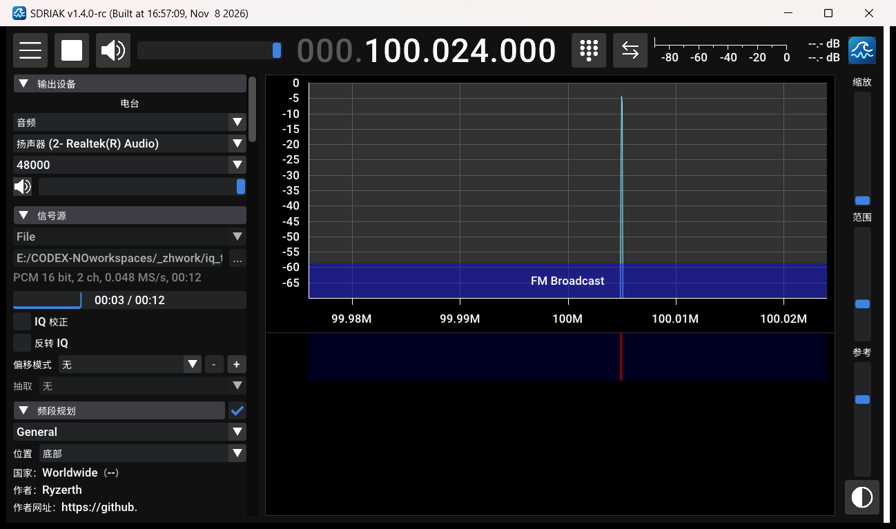
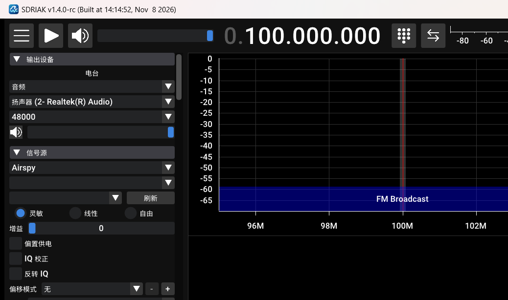
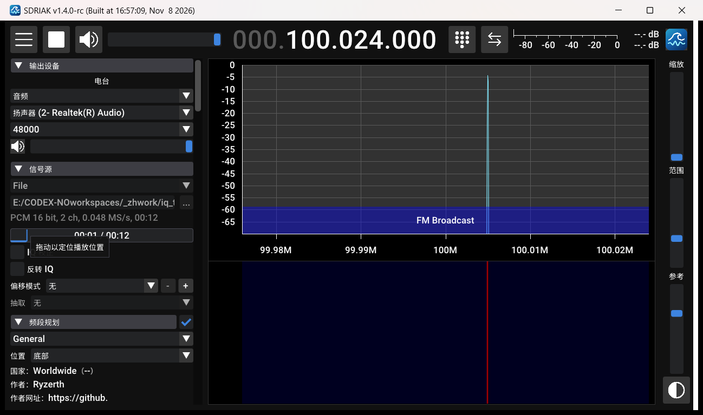

# SDRIAK 简体中文版

SDRIAK 是 SDR++ 的一个跨平台分支（Windows / Linux / macOS / Android），由 Vojtech Bubnik（OK1IAK）维护。这个仓库是它的简体中文版本：界面已汉化，另外加了文件播放进度条等几处改动。

- 原项目：[bubnikv/SDRPlusPlus-iak](https://github.com/bubnikv/SDRPlusPlus-iak)
- 上游：[AlexandreRouma/SDRPlusPlus](https://github.com/AlexandreRouma/SDRPlusPlus)
- 问题反馈：[Issues](https://github.com/lzh173/sdriak-zh/issues)

## 界面



右侧瀑布图来自一段 IQ 录音，文件源正在播放，左侧是中文面板。



输出设备的流名称和 provider 名称（“音频”）也做了显示映射，配置文件里保存的仍是英文内部名。



文件源播放时可以拖动进度条定位，悬停会显示提示。

## 中文版的改动

**界面汉化**：主窗口、菜单、对话框、频率输入、频段选择器、模块管理器，以及信号源、输出设备、解码器、频率管理器、录音、扫描器、定时任务等模块面板。术语做了统一；频率单位、协议缩写、硬件型号这类内容保留英文，具体范围见 [doc/zh-cn.md](doc/zh-cn.md)。

**中文字体**：包内附带 Noto Sans SC 子集（OFL 许可），不依赖系统安装的中文字体；按界面实际用字裁剪，桌面版额外带常用汉字，书签、站点名等用户输入也能正常显示。菜单标题是在绘制时做名称映射，配置键没有改动，旧配置可以直接继续用。

**文件播放进度条**：文件源载入 WAV / FLAC 后，面板里显示已播放时间和总时长，点击或拖动即可跳转；停止状态下拖动可以设置下一次播放的起点。播放线程独占文件读取，界面只读原子位置并提交定位请求，不跟播放线程抢文件 I/O。

其余功能和上游一致：多 VFO、瀑布图、频段规划、录音、各类 SDR 硬件支持等。

## 下载

在 [Releases](https://github.com/lzh173/sdriak-zh/releases) 页面下载对应平台的包：

- **Windows**：`windows-x64` / `windows-arm64`，解压后运行 `sdriak.exe`，配置和录音默认保存在程序目录
- **Linux**：`.deb` 包（Debian、Ubuntu 多个版本）或 AppImage
- **macOS**：Intel / Apple Silicon 压缩包
- **Android**：`android-arm.apk` / `android-x86.apk`，lzh173 发布签名，可直接安装

当前版本 1.4.4-zh（基于 SDRIAK 1.4.0-rc 的汉化版，版本号带 -zh 后缀以与上游主线区分）。

## 说明

- 界面是单语中文，没有运行时语言切换；需要英文界面请使用上游版本。
- `--autostart` 不会自动播放文件源，需要在文件源面板里点播放。这是上游的文件加载时序，这里没有改动。
- 频段名称（`root/res/bandplans` 和频段选择器）保留英文，避免影响频段识别。
- 模块管理器里的模块描述字段不显示，因此没有翻译；日志和命令行帮助也保持英文。

## 构建

构建步骤和上游一致，见[英文 readme](readme.md)，以及 [doc/build-windows.md](doc/build-windows.md)、[doc/appimage.md](doc/appimage.md)。

改完中文文案后需要重新生成字体和菜单映射：

```bash
python scripts/zh/gen_cjk_glyphs.py
python scripts/zh/gen_menu_names.py
```

## 致谢

基于 Vojtech Bubnik (OK1IAK) 的 SDRIAK 和 Alexandre Rouma (ON5RYZ) 的 SDR++，以及各模块作者的贡献。完整名单见程序内的 Credits 窗口和上游仓库。

本仓库的简体中文汉化（界面翻译、中文字体与文档）由 lzh173（BI7KGA）完成。

本项目遵循 GPLv3；Noto Sans SC 字体遵循 SIL Open Font License，许可见 `root/res/licenses/`。
